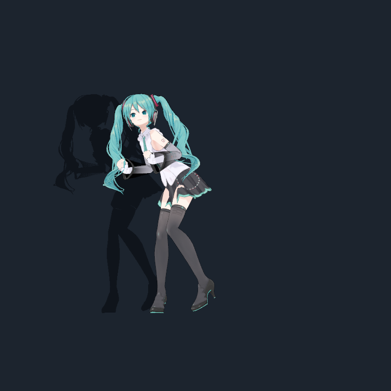
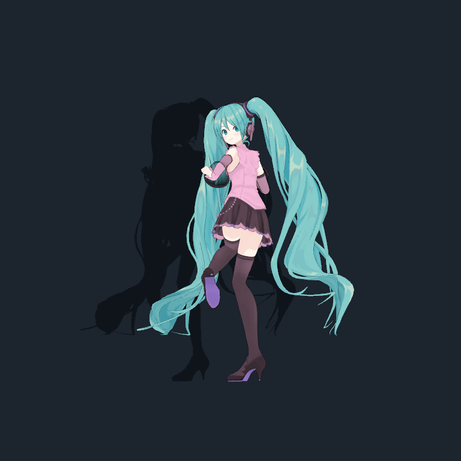

# Mao Mate Miku

Bạn đồng hành 3D trên desktop Windows, phát triển từ [Mate Engine](https://github.com/shinyflvre/Mate-Engine). Miku có biểu cảm, tùy chỉnh ngoại hình, trò chuyện tiếng Việt qua API AI và công cụ làm việc với file theo chế độ quyền bạn chọn.

**Bản cộng đồng hiện tại là source preview dành cho người có thể dùng Unity. Chưa có bộ cài `.exe` phát hành.** Model Miku và một số asset dùng riêng không đi kèm; cần bổ sung trước khi build. Một bản clone mới chưa thể bấm Build và chạy ngay. Xem [yêu cầu asset](docs/ASSETS.md) trước khi tải Unity.

<p align="center">
  
  
</p>

Ảnh thật từ chức năng preview của bản Windows đang cài, chụp ngày 09/11/2026; không phải ảnh dựng giao diện. Model: **Tomaru / 止丸**; Hatsune Miku © Crypton Future Media, Inc. Ảnh không chứng minh bản source đã lọc asset có thể build ngay. [Chi tiết ảnh và kiểm chứng](docs/SCREENSHOTS.md).

## Bắt đầu

1. Đọc [hướng dẫn cài và build Windows](docs/INSTALL_VI.md).
2. Tải model trực tiếp từ [trang Tomaru trên BOOTH](https://booth.pm/en/items/3226395) và chuẩn bị [asset còn thiếu](docs/ASSETS.md).
3. Sau khi build thành công, mở `Mao Mate Engine.exe`, làm theo [hướng dẫn sử dụng](docs/USAGE_VI.md).

```powershell
git clone -c core.longpaths=true https://github.com/dangthailinh/mao-mate-miku.git
cd mao-mate-miku
powershell -NoProfile -File .\scripts\Check-Setup.ps1
```

Lệnh kiểm tra chỉ đọc máy và báo các đầu vào còn thiếu. Nó không tải asset, cài phần mềm, sửa cấu hình hay đọc khóa API.

## Có gì trong source?

| Phần | Chức năng |
|---|---|
| Avatar | Model VRM, biểu cảm, pose, thay đổi ngoại hình, tương tác desktop |
| Trò chuyện | Tiếng Việt, lịch sử hội thoại, các backend AI cấu hình bằng khóa riêng |
| Công cụ | Đọc/ghi file, ghi chú, mở ứng dụng/URL và PowerShell qua Miku Harness |
| Quyền | Chỉ đọc, Hỏi trước, Full access; có từ chối và dừng tác vụ |
| Vision/giọng nói | Tích hợp sẵn trong code, cần cấu hình dịch vụ tương ứng |

Một số tính năng avatar cần asset ngoài repo. Dịch vụ AI có thể tính phí, hết hạn ngạch hoặc tạm lỗi. Không có khóa API được cấp kèm. Đây là bản tùy biến cá nhân đang mở source; một số câu thoại vẫn gọi chủ máy là “Linh”.

## Dành cho người phát triển

- Unity **6000.2.6f2**, Windows 64-bit; Node được kiểm tra trên máy duy trì: **24.18.0**.
- Scene chính: `Assets/MATE ENGINE - Scenes/Mate Engine Main.unity`.
- Runtime/core/tests: `Assets/MaoIntegration/`; cầu nối Node: `Tools/MikuHarness/`.
- Build: menu **Mao → Build Windows App**, hoặc `MaoMateBuild.BuildWindowsApp` trong batch mode.
- Test Node: vào `Tools/MikuHarness`, chạy `npm.cmd ci --ignore-scripts`, rồi `npm.cmd test`.
- [Đóng góp](CONTRIBUTING.md) · [Quyền và dữ liệu](docs/USAGE_VI.md#quyền-và-dữ-liệu) · [Kết quả kiểm tra lần công khai](docs/VERIFICATION.md).

## Nguồn và giấy phép

Giữ nguyên [MateEngine Pro License v2.1](LICENSE.md), [NOTICE](NOTICE.txt) và các giấy phép thành phần. Đây là source công khai với điều kiện **phi thương mại**; không gắn nhãn MIT/Apache cho toàn bộ dự án. Code gốc: Johnson Jason; tài nguyên Mate Engine: Shiny và các tác giả được ghi trong dự án. [README của upstream](docs/UPSTREAM_README.md) chỉ để tham khảo nguồn gốc, không phải hướng dẫn cài bản fork này.

Model Tomaru được tải riêng: tác giả cho dùng ảnh/video minh họa nhưng cấm phân phối lại dữ liệu model. Không đính kèm model, khóa API, log cá nhân hoặc nhạc thương mại vào issue/PR/release. [Nguồn asset và phạm vi bản public](docs/ASSETS.md).

## English

Windows desktop companion based on Mate Engine, with Vietnamese AI chat and permission-controlled local tools. **Source preview, no downloadable installer yet.** Unity 6000.2.6f2, user-provided VRM and licensed motion assets are required. The public export has not been rebuilt in Unity. See the Vietnamese guides above and the original license; this is a non-commercial community fork, not an official Hatsune Miku product.
