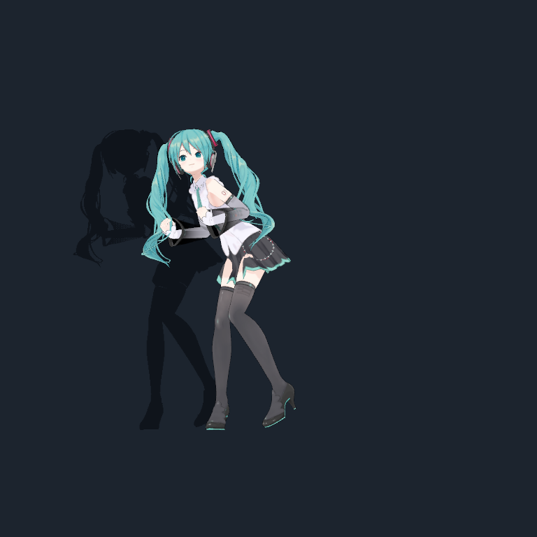

# Cài và build trên Windows

## Trước khi bắt đầu

Bản này dành cho Windows 64-bit và người dùng Unity. Repo chưa phát hành bộ cài. Cần tự bổ sung model và 10 chuyển động Humanoid bắt buộc; nếu không có chúng, dừng ở bước kiểm tra đầu vào. Không cần cài OpenClaw: `.openclaw` chỉ là tên thư mục cấu hình mà code hiện tại đọc.

## 1. Cài công cụ

- Cài Git, [Unity Hub](https://unity.com/download) và Unity Editor **6000.2.6f2**, hỗ trợ build Windows. Không tự nâng phiên bản project trong lần mở đầu tiên.
- Cài [Node.js](https://nodejs.org/en/download) cho Windows, với `node.exe` ở **`C:\Program Files\nodejs\node.exe`**. Script đóng gói hiện tìm đúng đường dẫn đó. Node 24.18.0 là phiên bản đã dùng để kiểm tra bridge trong lần công khai này.
- Dành chỗ cho Unity, `Library` và output build. Repo không chứa cache Unity; lần import đầu tiên sẽ tạo lại cache.

## 2. Tải source

```powershell
git clone -c core.longpaths=true https://github.com/dangthailinh/mao-mate-miku.git
cd mao-mate-miku
```

Nên clone vào đường dẫn ngắn, ví dụ `C:\src`, vì project có tên asset dài. Tùy chọn `core.longpaths=true` bật hỗ trợ đường dẫn dài riêng cho repo Git; không sửa cấu hình Windows. Nếu dùng ZIP mà Explorer báo đường dẫn quá dài, dùng cách clone ở trên.

Cũng có thể chọn **Code → Download ZIP** trên GitHub rồi giải nén. Tất cả lệnh phía dưới chạy từ thư mục chứa `Assets`, `Packages`, `ProjectSettings`.

## 3. Chuẩn bị model và chuyển động

1. Mở [trang model Tomaru](https://booth.pm/en/items/3226395), đọc điều kiện và tải từ tác giả.
2. Giải nén, lấy file VRM phù hợp, đặt tên `hatsune-miku.vrm` và chép vào `AvatarAssets`. Không cần import toàn bộ unitypackage VRChat của model.
3. Bổ sung 10 FBX Humanoid theo [bảng tên và đường dẫn](ASSETS.md). Chỉ dùng asset bạn được phép dùng. Giữ tên chính xác; tên đúng chưa đủ, rig và clip cũng phải hợp lệ.
4. Chạy kiểm tra:

```powershell
powershell -NoProfile -File .\scripts\Check-Setup.ps1
```

Kết quả **MISSING** trên clone mới là dự kiến. Script kiểm tra sự tồn tại; việc Humanoid/animation có hợp lệ cần Unity xác nhận. Các pose/ghế/đàn/nhạc riêng cũng không kèm repo; tính năng liên quan có thể thiếu hình ảnh/chuyển động. Không sử dụng bản build thiếu asset làm bản phát hành đã hoàn thiện.

## 4. Cài cầu nối AI

```powershell
Push-Location .\Tools\MikuHarness
npm.cmd ci --ignore-scripts
if ($LASTEXITCODE -ne 0) { throw 'Cài dependency thất bại' }
npm.cmd test
if ($LASTEXITCODE -ne 0) { throw 'Test thất bại' }
Pop-Location
```

Giữ `package-lock.json`; không chạy `npm audit fix --force` để vượt lỗi cài đặt. Test Node không thay cho build/test Unity.

## 5. Mở Unity và build

1. Unity Hub → **Add project from disk** → chọn thư mục repo.
2. Mở bằng 6000.2.6f2; chờ package/import xong. Giải quyết lỗi đỏ trong Console trước.
3. Mở scene `Assets/MATE ENGINE - Scenes/Mate Engine Main.unity`.
4. Chọn **Mao → Build Windows App**. Script kiểm tra chuyển động, build Windows, chép VRM/pose và đóng gói Node Harness.
5. Output mặc định nằm **cạnh thư mục repo**: `build\Mao Mate Engine\`.

Nếu muốn chọn output rõ ràng, đóng project trong Unity trước khi dùng batch mode:

```powershell
$unityEditor = 'C:\Program Files\Unity\Hub\Editor\6000.2.6f2\Editor\Unity.exe'
$projectDirectory = (Get-Location).Path
$buildDirectory = Join-Path $projectDirectory 'Builds\Community'
$buildLog = Join-Path $projectDirectory 'community-build.log'
& $unityEditor -batchmode -quit -projectPath $projectDirectory -buildTarget StandaloneWindows64 -executeMethod MaoMateBuild.BuildWindowsApp "--mao-build-output=$buildDirectory" -logFile $buildLog
```

Sửa `$unityEditor` nếu cài Unity nơi khác. Chờ Unity kết thúc, đọc log và kiểm tra build báo thành công. Đừng chỉ dựa vào việc thư mục output đã xuất hiện. [Tham khảo batch build của Unity](https://docs.unity3d.com/6000.2/Documentation/Manual/build-command-line.html).

## 6. Chạy ứng dụng

Mở **`Mao Mate Engine.exe`** trong output. Giữ nguyên toàn bộ thư mục cạnh file exe, bao gồm `*_Data`, các DLL và `MaoAssets`; không chép riêng exe. Chưa cần API key để kiểm tra avatar xuất hiện.



Ảnh trên là bản cài đầy đủ dùng asset riêng của người duy trì. Bản tự build có thể khác nếu dùng model/chuyển động khác. Tiếp tục [cấu hình AI và thao tác](USAGE_VI.md).

## Khi gặp lỗi

| Hiện tượng | Kiểm tra |
|---|---|
| Required Mao asset not found | `AvatarAssets/hatsune-miku.vrm` và `AvatarAssets/MikuPoses.json` |
| Lỗi FemaleLocomotion / Humanoid | Đủ 10 FBX, đúng đường dẫn, rig Humanoid hợp lệ; xem `ASSETS.md` |
| Install pinned Harness dependencies | Chạy `npm.cmd ci --ignore-scripts` trong `Tools/MikuHarness` |
| A Node runtime is required | `C:\Program Files\nodejs\node.exe` tồn tại |
| Package/compile error | Đúng Unity 6000.2.6f2; Git hoạt động để tải UniTask; đọc lỗi đầu tiên trong Console |
| AI không trả lời | Kiểm tra khóa, endpoint/quota; mã 503 hoặc timeout có thể do nhà cung cấp |
| Không có ghế/đàn/pose đặc biệt | Asset tương ứng được loại khỏi bản public; không phải lỗi cài API |

Khi báo lỗi, ghi Windows/Unity/Node, bước tái hiện và đoạn log liên quan đã xóa khóa/token/nội dung cá nhân. Không tải cả thư mục dữ liệu ứng dụng lên GitHub.
