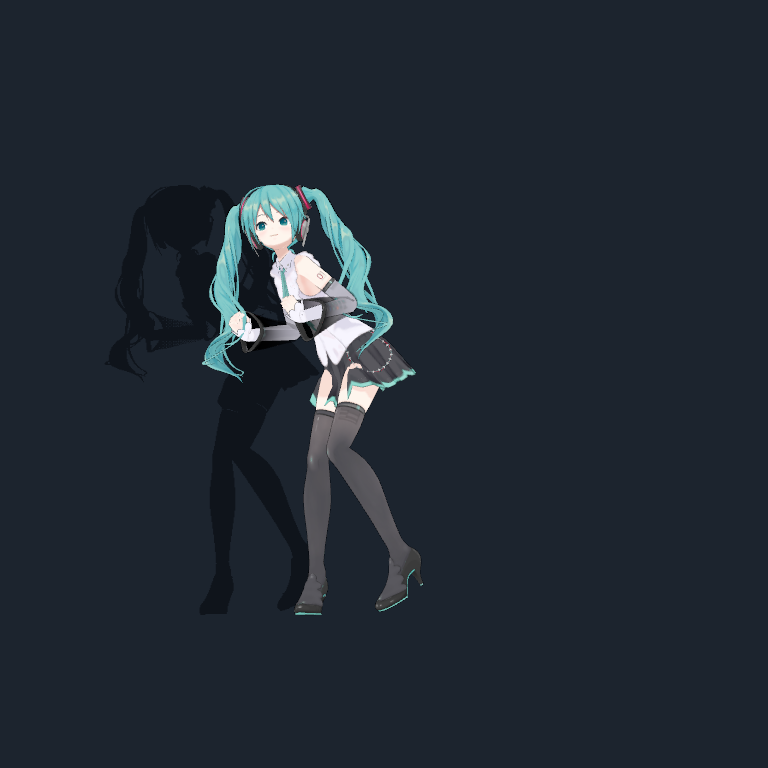
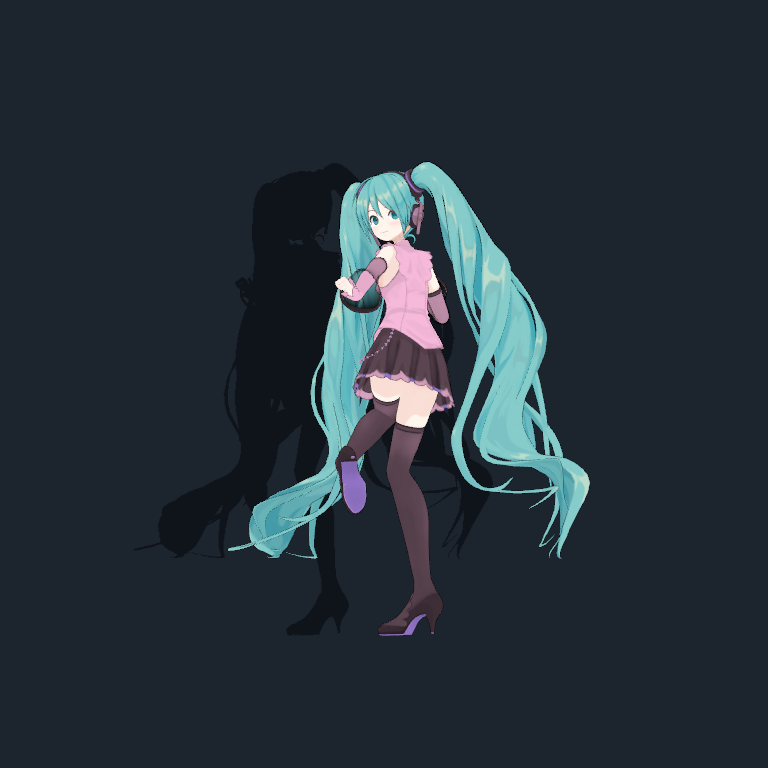

# Ảnh từ ứng dụng

Hai ảnh được xuất bằng chức năng `--mao-smoke-appearance` của ứng dụng Windows đã cài, ngày **09/11/2026**. Đây là frame render thực trong lượt chạy, không phải mockup hoặc ảnh tạo bằng AI.

| Ảnh | Nội dung |
|---|---|
| [Nguyên bản](images/miku-original.png) | Preview model với cấu hình nguyên bản |
| [Pastel](images/miku-pastel.png) | Preview preset thay đổi ngoại hình |

Model: Tomaru / 止丸, [trang tác giả và điều kiện dùng ảnh](https://booth.pm/en/items/3226395). Hatsune Miku © Crypton Future Media, Inc.

Ảnh lấy từ bản cài đầy đủ với asset riêng, không phải một bản build mới từ source public. Lượt capture báo `failures=0` cho các preview ngoại hình. Ảnh không xác nhận chat/voice/API hoạt động; lượt chạy có lỗi provider 503/timeout. Không công khai ảnh bảng quyền vì ảnh đó chứa đường dẫn workspace cá nhân.
