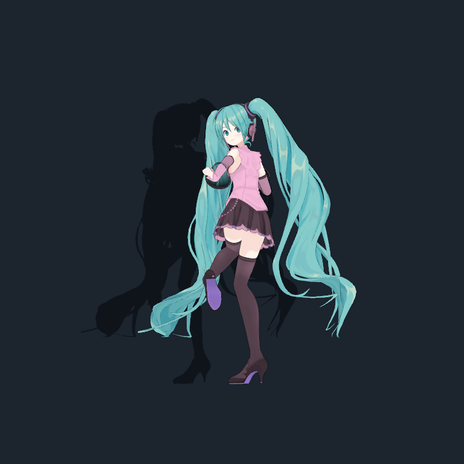

# Sử dụng Mao Mate Miku

## Lần chạy đầu

Mở exe trong thư mục đã build. Nhấn **F1** để mở/đóng menu vòng khi ứng dụng đang nhận bàn phím. Trong menu, **POSE** mở lựa chọn tư thế; các lựa chọn **NGỒI/MẶT** nằm trong phần pose. **QUYỀN** mở bảng quyền. Một số lựa chọn cần asset bổ sung.

Trong màn hình chat/console của ứng dụng, gõ tin nhắn và nhấn Enter để gửi. Các lệnh bên dưới được nhập ở ô chat. Tùy bản scene/giao diện, mở phần chat từ menu; không dùng Space làm phím mở chat.

## Cấu hình AI

Bạn tự cấp khóa của nhà cung cấp. Dịch vụ có thể tính phí. Không cần dùng tất cả các provider và không có đảm bảo endpoint miễn phí luôn hoạt động.

Trong Explorer, nhập **`%USERPROFILE%\.openclaw`**; tạo thư mục nếu chưa có. Dùng trình soạn thảo để tạo một trong các file sau, theo provider bạn có:

| File | Dòng cấu hình | Phạm vi |
|---|---|---|
| `.env` | `GEMINI_API_KEY=YOUR_KEY_HERE` | Chat Gemini và ảnh/vision |
| `qwen.env` | `TOKENROUTER_API_KEY=YOUR_KEY_HERE` | Chat TokenRouter và Harness |
| `hhtech.env` | `HHTECH_API_KEY=YOUR_KEY_HERE` | HHTech, khi bản build cho phép provider này |
| `deepseek.env` | `DEEPSEEK_API_KEY=YOUR_KEY_HERE` | Harness; không phải backend chat thường của Unity |

Thay `YOUR_KEY_HERE` bằng khóa của bạn. File phải đúng đuôi, ví dụ `qwen.env`, không phải `qwen.env.txt`. Không nhập khóa vào chat, issue hay source. Đóng rồi mở lại ứng dụng. Provider có thứ tự ưu tiên/fallback trong code; có nhiều khóa không đồng nghĩa mọi tính năng sẽ dùng cùng provider.

Thử tin nhắn ngắn: `Chào Miku, giới thiệu một câu nhé`. Nếu không trả lời, xem lỗi kết nối/quota; đừng cấp Full access chỉ để sửa kết nối AI.

## Quyền và dữ liệu

Mở **QUYỀN** hoặc nhập `/permissions`. Nên bắt đầu bằng **Hỏi trước** hoặc **Chỉ đọc**.

| Chế độ | Hành vi |
|---|---|
| Chỉ đọc | Cho công cụ đọc giới hạn; không ghi file/chạy PowerShell |
| Hỏi trước | Yêu cầu duyệt từng thao tác ghi/mở/chạy |
| Full access | Thực thi tác vụ được giao bằng quyền tài khoản Windows hiện tại |

Full access không tự cấp Administrator. Workspace giúp chọn thư mục làm việc, **không phải sandbox hệ điều hành**; công cụ mạnh có thể truy cập các đường dẫn tài khoản Windows cho phép. Khi chọn Full access, bạn bỏ bước duyệt từng hành động.

Ví dụ bắt đầu với thư mục thử nghiệm bạn đã tạo:

```text
/permissions ask
/workspace C:\MikuWorkspace
Liệt kê file trong workspace và giải thích tên từng file.
Tạo file hello.txt trong workspace với nội dung Xin chào.
Miku dừng tác vụ lại đi
```

Lệnh ghi sẽ cần bạn duyệt trong chế độ Hỏi trước. Từ chối nếu nội dung không đúng yêu cầu. Dừng tác vụ không hoàn tác thao tác đã xong. Xem [thiết kế quyền](MIKU_PERMISSIONS.md) để biết giới hạn công cụ.

Chat và ngữ cảnh cần thiết cho tác vụ được gửi tới nhà cung cấp AI đã cấu hình. **F8** bật/tắt Screen Vision; khi bật, nội dung màn hình có thể được gửi cho dịch vụ AI. **F9** bật/tắt tính năng giọng nói, cần dịch vụ âm thanh tương ứng. Bản public này chưa kiểm thử đầy đủ dịch vụ voice trên máy mới.

Dữ liệu cục bộ nằm tại `%USERPROFILE%\AppData\LocalLow\Linh\Mao Mate Engine`, có thể chứa hội thoại, ghi chú, cấu hình và bản sao file đã sửa. Một số thiết lập Unity còn nằm trong PlayerPrefs. Không đưa thư mục này vào Git. Muốn gỡ bản tự build: thoát app rồi xóa thư mục output đã build; dữ liệu và khóa riêng ở vị trí khác vẫn còn, hãy tự quyết định giữ hay xóa chúng sau khi sao lưu.

## Ngoại hình và ảnh minh họa



Đây là preset pastel được chức năng thử ngoại hình của app render, không phải màn hình cài đặt. Chụp ngày 09/11/2026 trên bản cài đầy đủ. Model Tomaru / 止丸; Hatsune Miku © Crypton Future Media, Inc. Xem [nguồn ảnh](SCREENSHOTS.md).

F2/Shift+F2 chuyển pose và F3 dừng **chỉ khi** `enableKeyboardShortcuts` được bật trong controller; sử dụng menu POSE nếu phím không hoạt động.
